# FastFish

Detailed fish drawings, made with JavaScript. FastFish builds on **[Fishdraw by Lingdong Huang](https://github.com/LingDong-/fishdraw)**, keeping its intricate line art and compatible API while making generation much faster.

**[Open the live demo →](https://franky-fishdraw-studio-v2.frankmarsman.chatgpt.site/)**

Start drawing fish immediately in your browser. No download or installation needed.

## Animated samples

Twenty fish, each morphing into a different shape. Click any animation to open it on its own.

Within each group: fine scales, layered scales, crosshatch and linear.

**Plain**

<p>
<a href="samples/morph-01.gif">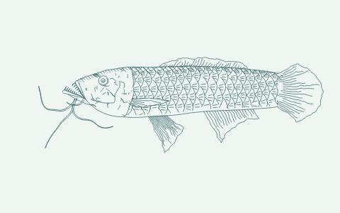</a>
<a href="samples/morph-02.gif">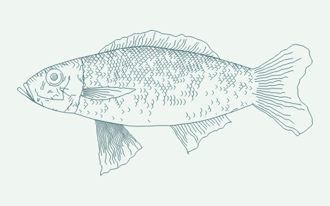</a>
<a href="samples/morph-03.gif">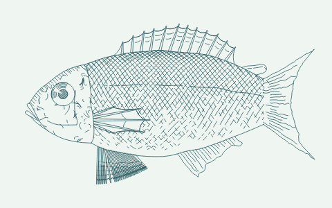</a>
<a href="samples/morph-04.gif">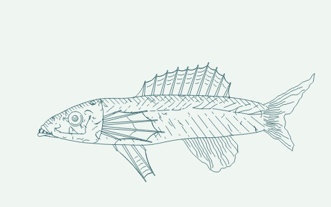</a>
</p>

**Spots**

<p>
<a href="samples/morph-05.gif">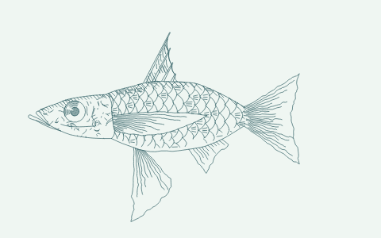</a>
<a href="samples/morph-06.gif">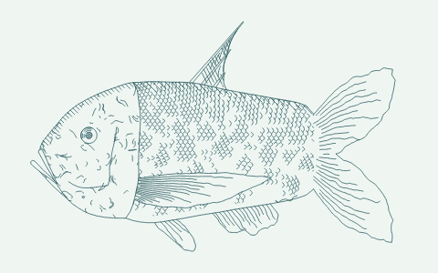</a>
<a href="samples/morph-07.gif">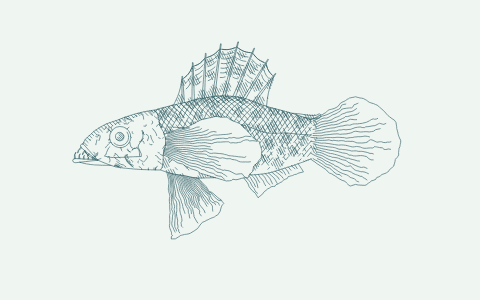</a>
<a href="samples/morph-08.gif">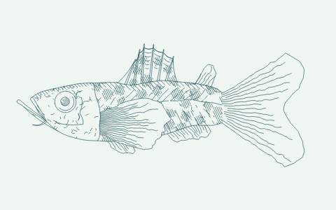</a>
</p>

**Mottled**

<p>
<a href="samples/morph-09.gif">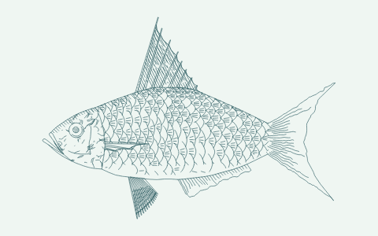</a>
<a href="samples/morph-10.gif">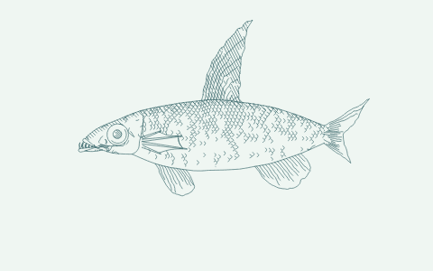</a>
<a href="samples/morph-11.gif">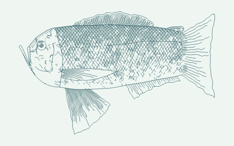</a>
<a href="samples/morph-12.gif">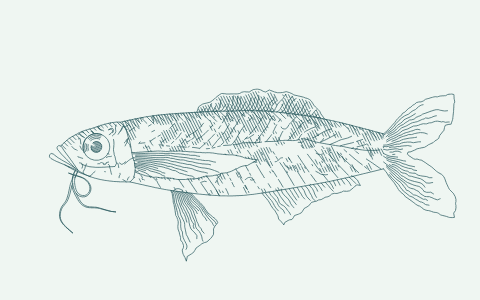</a>
</p>

**Stripes**

<p>
<a href="samples/morph-13.gif">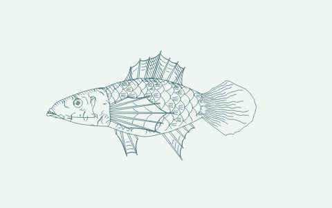</a>
<a href="samples/morph-14.gif">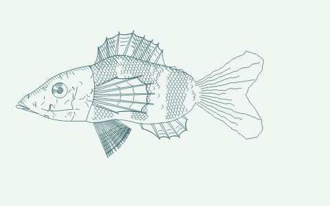</a>
<a href="samples/morph-15.gif">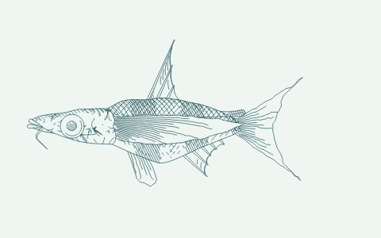</a>
<a href="samples/morph-16.gif">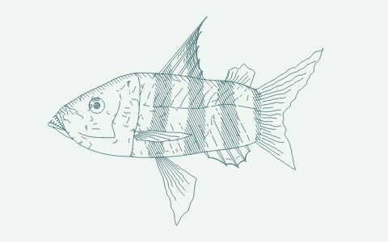</a>
</p>

**Speckles**

<p>
<a href="samples/morph-17.gif">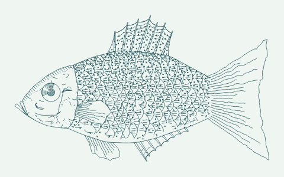</a>
<a href="samples/morph-18.gif">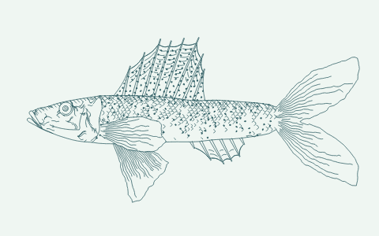</a>
<a href="samples/morph-19.gif">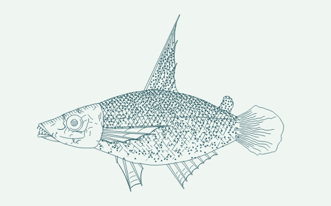</a>
<a href="samples/morph-20.gif">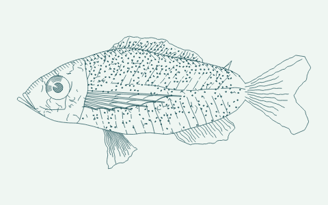</a>
</p>

Each loop uses 25 steps, with the drawing seed and categorical settings held fixed. The gallery covers all four scale styles and five body patterns. [GIF files and how to recreate them →](samples/README.md)

## Generation speed

The Fast generator was **12–14× as fast** as the original in these four examples:

| Style | Original Fishdraw | FastFish | Speed-up |
| --- | ---: | ---: | ---: |
| Layered scales | 531.9 ms | 37.3 ms | **14.3×** |
| Fine scales | 1,399.2 ms | 106.7 ms | **13.1×** |
| Crosshatch | 202.4 ms | 16.8 ms | **12.0×** |
| Linear | 117.0 ms | 9.6 ms | **12.2×** |

Drawing calculation only, on an Apple M1 with Node.js 24.1.0. Medians of seven runs after three warm-ups, using the same seed and parameters with matching geometry. Results vary by fish and device. [Method and raw results](benchmarks/results/original-vs-fast-v2.md) · [Larger Fast v1/v2 benchmark](benchmarks/README.md)

## Try the live demo

[Open FastFish](https://franky-fishdraw-studio-v2.frankmarsman.chatgpt.site/) and experiment with the controls:

- **Sliders** adjust the fish’s proportions and details. **Dials** choose categories: drag to rotate or click a label. **Toggles** switch between two options.
- **New fish ↗** picks new numerical settings, prepares 25 frames while the progress bar fills, then plays the morph. Your dial and toggle choices stay fixed; controls unlock when it finishes.
- **Reset** restores the default parameters, keeping the current seed.
- **Seed** changes the drawing’s random details. The same seed and settings reproduce the same fish.
- **+ / − and Fit** zoom in, zoom out and bring the whole fish back into view. Drag the preview to pan when zoomed in.
- **SVG ↓** downloads the current fish as a scalable vector image. **Fullscreen** expands the interface.

The preview also shows **Fish generation** time and **Total draw time**, which includes the work needed to display the fish.

[](https://franky-fishdraw-studio-v2.frankmarsman.chatgpt.site/)

Want to edit or run the site locally? See the [developer instructions](demo/README.md).

## A screen full of fish — V3

**[Open FastFish V3 →](https://frank-fish-v3.frankmarsman.chatgpt.site/)**

V3 fills your browser window with a composition of fish in different shapes and sizes. It packs their silhouettes closely together, with fish facing left or right and gently tilted.

- **Fish count** sets a target of 50–5,000 fish. The status shows how many fit.
- **Gap** adjusts the minimum space between fish, from 0–20 screen pixels.

The composition prepares automatically when you change a slider or resize the window. Larger collections take longer to prepare; spacing changes reuse the fish already generated. Every fish stays inside the drawing area.

### Composition gallery

Four compositions generated in one loop, with increasing canvas sizes and fish-count targets. All use a **4 px gap**. Click an image to open the full-resolution PNG.

<p>
<a href="demo-v3/media/gallery/composition-500-500.png">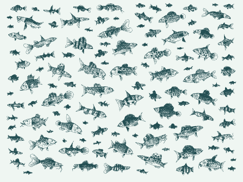</a>
<a href="demo-v3/media/gallery/composition-1000-1500.png">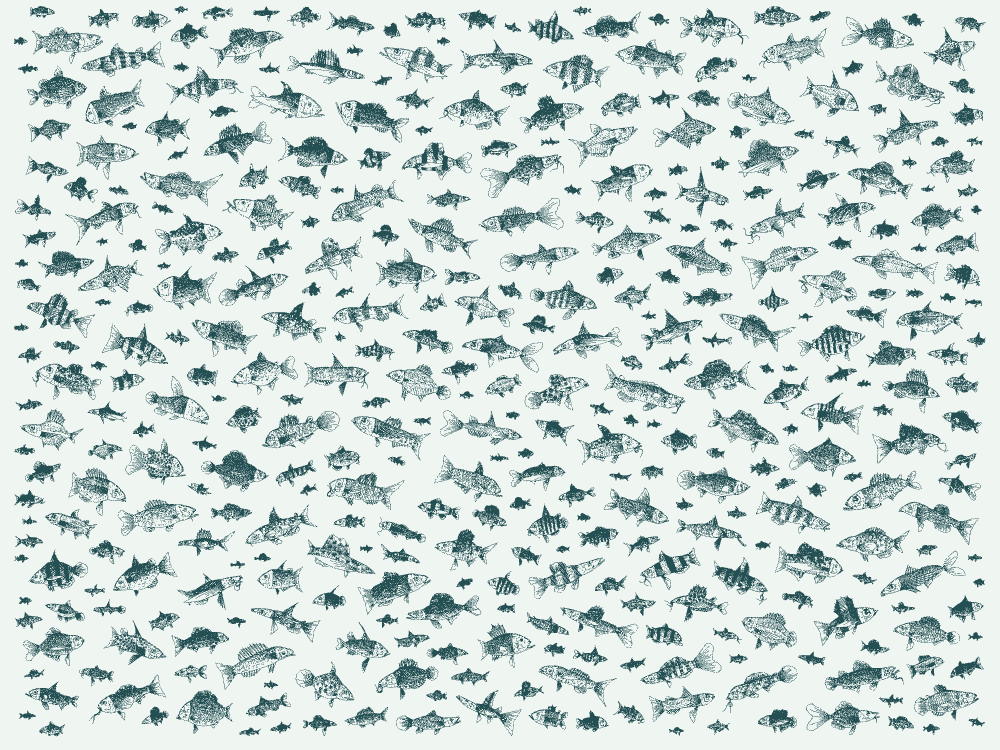</a>
<a href="demo-v3/media/gallery/composition-1500-3000.png">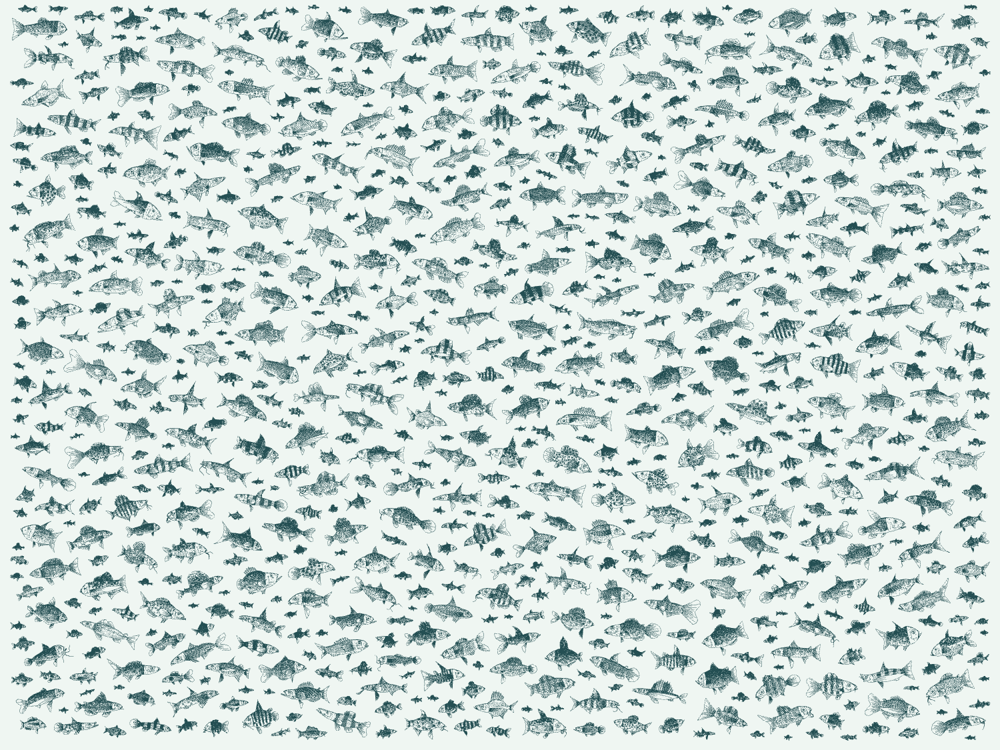</a>
<a href="demo-v3/media/gallery/composition-2000-5000.png">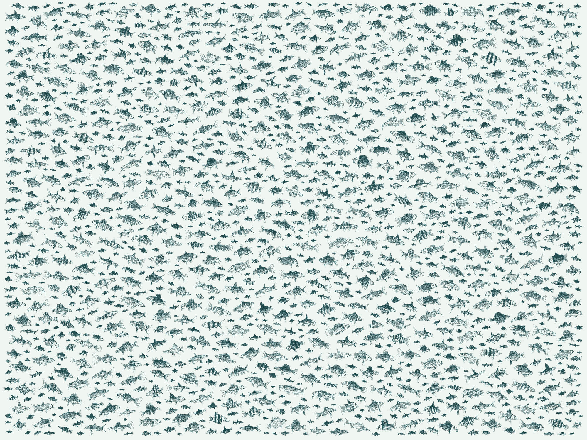</a>
</p>

| Image size (px) | Target fish | Fish placed |
| --- | ---: | ---: |
| [500 × 375](demo-v3/media/gallery/composition-500-500.png) | 500 | 121 |
| [1,000 × 750](demo-v3/media/gallery/composition-1000-1500.png) | 1,500 | 403 |
| [1,500 × 1,125](demo-v3/media/gallery/composition-1500-3000.png) | 3,000 | 822 |
| [2,000 × 1,500](demo-v3/media/gallery/composition-2000-5000.png) | 5,000 | 1,433 |

These are artwork renders with the controls omitted. [Settings and validation results](demo-v3/media/gallery/manifest.json) · [Regenerate the gallery](demo-v3/README.md#composition-gallery)

[Source and technical notes](demo-v3/README.md) · [Studio V2](https://franky-fishdraw-studio-v2.frankmarsman.chatgpt.site/)

## Use the library

Clone this repository, then generate a fish with Node.js:

```sh
git clone https://github.com/FrankMarsman/FastFish.git
cd FastFish
node FishDraw_Fast.js --seed "Franky fishus" > fish.svg
```

To choose the parameters yourself:

```js
const fs = require('node:fs');
const { fish, default_params, reframe, cleanup, draw_svg } = require('./FishDraw_Fast.js');

const params = { ...default_params(), body_length: 300, scale_type: 2 };
const lines = cleanup(reframe(fish(params), 20, ''));
fs.writeFileSync('fish.svg', draw_svg(lines));
```

`fish(params)` returns polylines; `draw_svg()` turns them into an SVG. The original exports are preserved. The unchanged `fishdraw.js` is included for comparison; use **`FishDraw_Fast.js`** for the faster version.

For an existing checkout, update the remote with `git remote set-url origin https://github.com/FrankMarsman/FastFish.git`.

## Credits and license

The fish drawing system and original artwork are by **Lingdong Huang**. FastFish adds performance improvements, the interactive studio and these animated examples. Released under the [MIT license](LICENSE), with the original copyright and attribution preserved.
