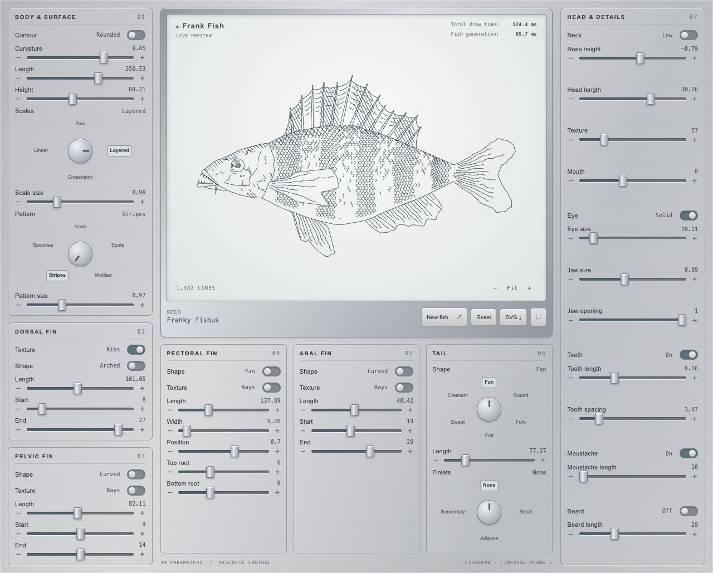
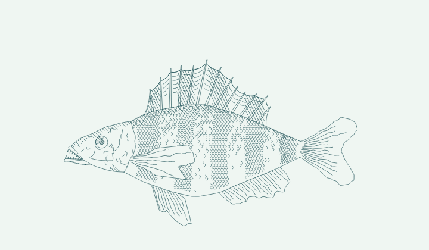
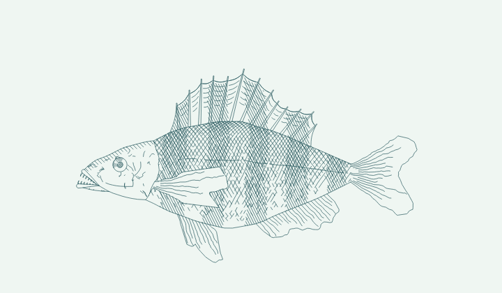
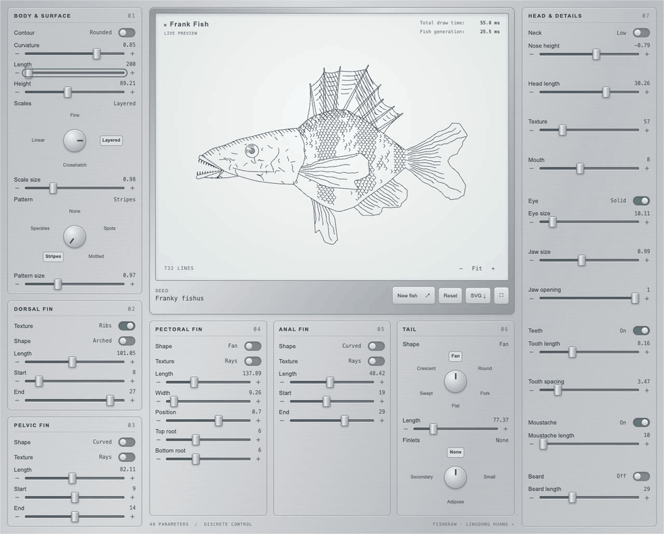
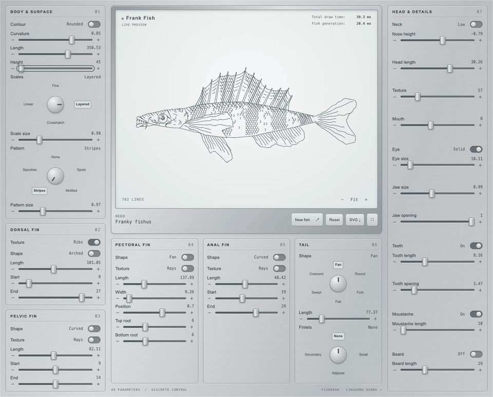
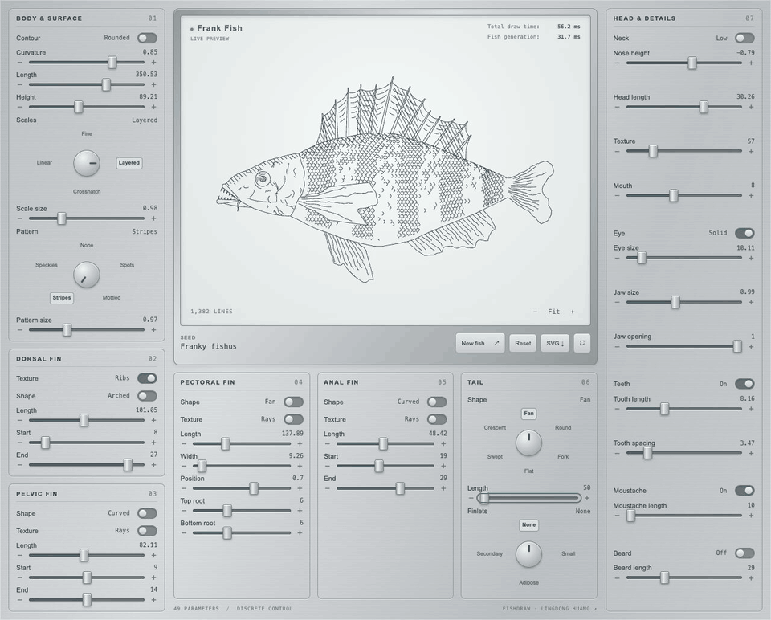

# FrankFish

Fast, procedural fish drawings in JavaScript. Based on **[Fishdraw by Lingdong Huang](https://github.com/LingDong-/fishdraw)**, FrankFish keeps the intricate line art and compatible generator API while reducing the cost of the geometry calculations.

**[Open Frank Fish →](https://franky-fishdraw-studio-v2.frankmarsman.chatgpt.site/)** · [Download the standalone demo](https://raw.githubusercontent.com/FrankMarsman/FrankFish/main/demo/index.html) · [MIT license](LICENSE)

`FishDraw_Fast.js` uses direct coordinate arguments, fixed-arity intersection keys and conservative clipping rejection tests to avoid unnecessary work. The original `fishdraw.js` is retained unchanged for comparison.

## Drawing speed

Median time spent inside `fish(params)` — generation only:

| Drawing style | Original Fishdraw | FrankFish Fast v2 | Speed-up |
| --- | ---: | ---: | ---: |
| Layered scales (Studio defaults) | 531.9 ms | 37.3 ms | **14.3×** |
| Fine scales | 1,399.2 ms | 106.7 ms | **13.1×** |
| Crosshatch | 202.4 ms | 16.8 ms | **12.0×** |
| Linear | 117.0 ms | 9.6 ms | **12.2×** |

Measured on an Apple M1 with Node.js 24.1.0: three warm-up runs and seven measured runs per engine and case, alternating execution order. Both engines use the same seed and parameters; full-precision geometry matches in all four cases. Times exclude cleanup, SVG conversion, worker startup and browser display, and vary with hardware and parameters.

[Method and raw results](benchmarks/results/original-vs-fast-v2.md) · [Reproduce the comparison](benchmarks/compare-original.cjs) · [Broader 2,048-configuration Fast v1/v2 benchmark](benchmarks/README.md)

## Frank Fish

Explore 49 parameters with sliders, switches and four categorical dials showing all their options. Frank Fish always uses the Fast generator. Rotate the categorical dials by dragging their knobs, click any category label, or use the arrow keys. Total draw time and fish generation time appear in the upper-right corner of the fish display.

[](https://franky-fishdraw-studio-v2.frankmarsman.chatgpt.site/)

**New fish** prepares 25 intermediate frames, shows progress, then plays the cached transition. Toggle values stay fixed, controls unlock at the endpoint, and the drawing panel keeps its size. Zoom, fullscreen and SVG download are included.

Two examples of the same interpolation process, rendered with the Fast generator:

| Layered scales | Crosshatch |
| --- | --- |
|  |  |

These loops omit preparation and play the 25 steps forward and backward at 20 fps, with pauses at the endpoints. [Seeds, parameters and reproduction instructions](demo/README.md#animation-examples) are included.

### Sliders in action

Full-panel recordings of one slider changing at a time, with the seed and all other parameters held fixed:

**Body length**



**Body height**



**Tail length**



Each clip contains real browser captures at all 20 slider positions, then reverses the frames. Playback is paced for clarity; these clips are not real-time benchmarks.

## Use the library

Clone this repository, then generate an SVG with Node.js:

```sh
node FishDraw_Fast.js --seed "Franky fishus" > fish.svg
```

Or use the compatible JavaScript API:

```js
const fs = require('node:fs');
const { fish, default_params, reframe, cleanup, draw_svg } = require('./FishDraw_Fast.js');

const params = { ...default_params(), body_length: 300, scale_type: 2 };
const lines = cleanup(reframe(fish(params), 20, ''));
fs.writeFileSync('fish.svg', draw_svg(lines));
```

`fish(params)` returns arrays of polylines. The original exports remain available, including `main(seed)` for a named fish and `generate_params()` for random parameters. The Studio worker demonstrates how to reset drawing randomness for repeatable comparisons.

## Run or adapt the demo

Save [demo/index.html](https://raw.githubusercontent.com/FrankMarsman/FrankFish/main/demo/index.html) and open it in a modern browser. It contains the styles, interface, the Fast generator and worker code, with no external runtime dependencies. It can also be served by any static web host.

Edit `demo/src/`, then run `node demo/build.cjs` to rebuild the single file. See [demo instructions and checks](demo/README.md).

## Credits

Fish geometry, procedural drawing techniques and the original implementation are by **Lingdong Huang**. FrankFish adds performance optimizations and the interactive Studio. Distributed under the [MIT license](LICENSE); the original copyright and license are preserved, including inside the standalone demo.
